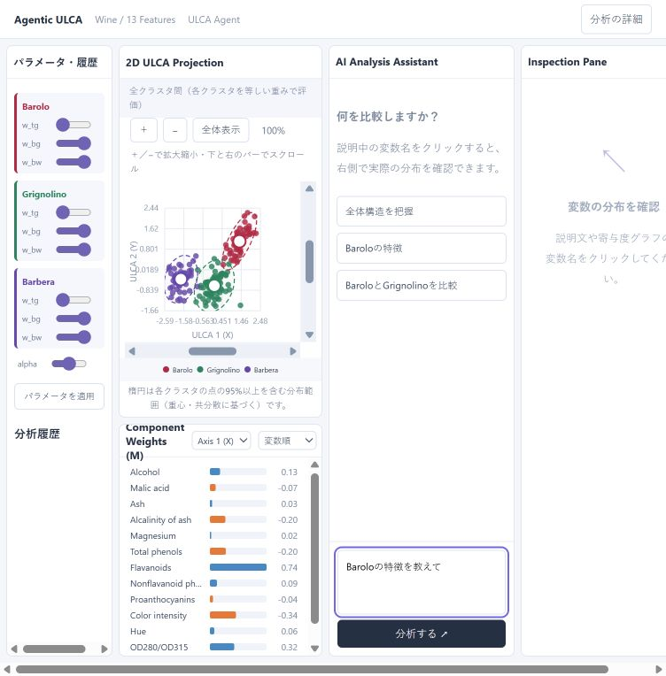

# ULCAagent

自然言語による分析指示と直接操作で、ULCA（User-guided Linear Component Analysis）の2次元投影を探索するローカルWebアプリです。WineとMNISTの数字0・6・9に対応しています。



## セットアップ・起動

Python 3.11で動作確認しています。以下はWindows PowerShellでの手順です。

```powershell
git clone https://github.com/sogoasahi/ULCAagent.git
cd ULCAagent
python -m venv .venv
.venv/Scripts/python.exe -m pip install -r backend/requirements.txt
.venv/Scripts/python.exe -m uvicorn backend.main:app --host 127.0.0.1 --port 8001
```

[分析画面](http://127.0.0.1:8001/)を開いてください。APIサーバーがHTML・JavaScript・CSSも配信するため、通常の起動にNode.jsや画面のビルドは不要です。停止はサーバーを起動したターミナルで `Ctrl+C` を押します。

LLMを使う場合は、起動前に次の設定を行ってください。LLMなしでも投影・ルール分類・定型説明・手動調整を利用できます。

## LLMの設定

`backend/llm.json` の `provider` で接続先を選びます。現在の既定値は `openai` です。環境変数 `ULCA_LLM_PROVIDER` がある場合はそちらを優先します。

| provider | 動作 |
|---|---|
| `openai` | OpenAI Responses APIで意図分類と散布図の説明を生成 |
| `ollama` | Ollama互換の `/api/chat` で分類と説明を生成 |
| `none` | LLMを使わず、ルール分類と数値に基づく定型説明を使用 |

### OpenAI

プロジェクトルートに `.env` を作成し、キーとモデルを設定します。

```dotenv
OPENAI_API_KEY=your_api_key
OPENAI_MODEL=gpt-4o-mini
```

`PROTOTYPE_OPENAI_KEY`・`PROTOTYPE_OPENAI_MODEL` が設定されている場合は、それぞれ通常の設定より優先します。OpenAI使用時のモデルは環境変数で指定し、`llm.json` の `model` はOllama用です。

既存の環境変数、`backend/.env`、ルートの `.env` の順で値を優先します。`.env` はGit管理対象外です。APIキーをコードやREADMEに記載しないでください。

### Ollama

`backend/llm.json` の `provider` を `ollama` に変更し、`base_url` と `model` に利用するサーバー・画像対応モデルを指定します。`OLLAMA_BASE_URL`・`OLLAMA_MODEL` で上書きできます。接続タイムアウトは10秒、応答待ちは同ファイルの `timeout_seconds`（既定180秒）です。

### 通信内容・エラー時の動作

ブラウザーはアプリのAPIに通信し、Pythonサーバーが選択したLLMに接続します。分類では入力文と参照知識、説明では散布図画像と投影係数・群の統計などの数値根拠を送ります。Ollamaまたは多数の変数を扱う説明では、係数・分離寄与の上位変数を選択し、送信する数値を小数4桁に丸めます。計算結果と画面の値は丸めず保持します。

LLMの通信・応答処理に失敗した場合は、画面に警告を表示してルール分類・定型説明へ切り替えます。別のプロバイダーへの自動転送は行いません。

- 接続設定は [APIステータス](http://127.0.0.1:8001/api/status) で確認できます。`llm_enabled` は設定の有効性を表し、疎通成功を意味しません。
- 通信エラー時は、サーバーを起動した環境から接続先に到達できるか、プロキシ設定も含めて確認してください。
- 認証エラーはキー・アクセス権、利用上限エラーは残高・利用制限を確認してください。
- 環境変数や `.env` の変更後はサーバーを再起動してください。

## データの切り替え

`backend/dataset.json` の `name` を変更し、サーバーを再起動して画面を再読み込みします。環境変数 `ULCA_DATASET` がある場合はそちらを優先します。

| name | データ | サンプル・変数 |
|---|---|---|
| `wine`（既定） | scikit-learn付属のWine | 178件・13変数・3群 |
| `mnist069` | MNISTの数字0・6・9 | 各500件、計1,500件・784画素 |

Wineの内部ラベル0・1・2は、画面ではBarolo（赤）・Grignolino（緑）・Barbera（紫）と表示します。

MNISTはscikit-learnのデータホーム内にある既存の `openml/openml.org/data/v1/download/52667/mnist_784.arff.gz` を読み込みます。データは同梱せず、自動ダウンロードも行いません。キャッシュの場所は `SCIKIT_LEARN_DATA` で指定できます。各数字の先頭500件を使用し、内部IDは0→数字0、1→数字6、2→数字9です。

MNISTの変数名 `Pixel(行,列)` は1始まりで、左上が `(1,1)` です。箱ひげ図は元の画素値（0〜255）、投影計算はWineと同じく変数ごとに標準化した値を使用します。

## 操作

1. 右のアシスタントに「全体構造を把握したい」「Baroloの特徴を教えて」「BaroloとGrignolinoを比較して」などと入力します。
2. 散布図と投影係数、説明を確認します。変数名をクリックすると、3群の元の値を箱ひげ図で比較できます。
3. 左のスライダーで重み・alphaを調整できます。重心・分布楕円のドラッグでは、指定した距離・面積比に近づくようパラメータを逆調整します。

- 初期表示は全群 `w_tg=0, w_bg=1, w_bw=1, alpha=10` で、最適化しません。自然言語による分析では200回のULCA評価で探索します。
- 「Baroloの内部構造の特性が見たい」「赤の多様性を見たい」は内部変動の探索です。対象群の分散を初期以上に保ち、他群に対する群内分散比を最大化します。このモードでは自動探索の `w_bw` を0に固定します。
- 重みは0〜1、alphaは0〜20です。`w_tg` と `w_bg` は独立して調整できます。
- 投影係数は変数順・絶対値順で表示できます。
- 散布図は＋／−で10〜10,000%に拡大縮小し、スクロールバー・ホイール・背景ドラッグで移動できます。Shift＋ホイールは横移動、「全体表示」で表示範囲を戻します。
- 「分析の詳細」では評価指標やLLMの応答時間を確認できます。履歴はブラウザーのメモリー内に保持し、画面の再読み込みで消えます。

### 分析結果の読み方

係数の符号・大きさだけから、元の値の高低や因果関係を判断することはできません。内部変動の探索も、サブクラスタの存在を保証するものではありません。

分布楕円は群の重心と共分散から向き・縦横比を決め、実際の点の95%以上を含む大きさで表示します。信頼区間ではありません。逆調整は目標形状の完全な再現を保証しません。

直線状・点に潰れた投影は失敗として扱います。自動探索・逆調整では採用せず、手動調整時には直前の散布図を保持します。計算・評価・解釈の詳細は [WORKFLOW.md](backend/knowledge/WORKFLOW.md) と [Interpretation.md](backend/knowledge/Interpretation.md) を参照してください。

## フォルダ構成

```text
backend/                 API・計算・LLM接続・設定
  main.py                サーバー起動口
  app.py                 API・入力検証・LLM連携
  engine.py              分類・探索・評価・逆調整
  ulca.py                固有値分解による投影
  dataset.py             データ読み込み
  ollama_client.py       Ollama接続
  prompts.py             説明用プロンプト
  knowledge/             実装に対応する参照知識
frontend/
  index.html             画面
  public/assets/         JavaScript・CSS
tests/                  回帰テスト
scripts/                手動のLLM接続確認
docs/                   説明資料・スクリーンショット
```

研究資料・過去のバックアップを保存したローカルの `archive/`、仮想環境、依存パッケージ、ログ、環境設定ファイルはGit管理対象外です。箱ひげ図のデータは `/api/dataset`、静的ファイルは `/assets/` から配信します。

## 開発・検証

### Pythonテスト

```powershell
.venv/Scripts/python.exe -m pip install -r requirements-dev.txt
$env:ULCA_DATASET = "wine"
.venv/Scripts/python.exe -m pytest tests -q -p no:cacheprovider
```

MNISTのテストはローカルキャッシュを用意して実行します。

```powershell
$env:ULCA_DATASET = "mnist069"
.venv/Scripts/python.exe -m pytest tests/test_mnist_dataset.py -q -p no:cacheprovider
Remove-Item Env:ULCA_DATASET
```

2026-11-09の確認では、Wine設定で67件成功・MNIST専用3件スキップ、MNIST専用テストは3件成功でした。LLM通信の回帰テストは模擬応答を使います。実通信の確認は別途必要です。

### フロントエンド

Node.jsとnpmがある環境で実行します。APIサーバーは別途8001番で起動してください。

```powershell
cd frontend
npm ci
npm run dev
```

開発画面は5173番、API接続先は8001番です。`npm run build` で `frontend/dist/` を生成できます。通常のPythonサーバーはビルド生成物ではなく、`frontend/` 内のHTMLと静的ファイルを配信します。
