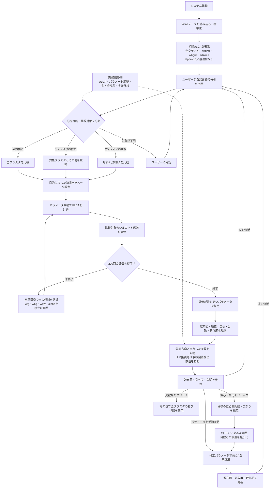

# ULCA Agent ワークフロー

## シルエット係数の評価対象

| 分析目的 | 評価する群 | 最大化する値 |
|---|---|---|
| 全体構造 | 元の全クラスタ | 各クラスタの平均シルエット係数を等重みで平均 |
| 1クラスタの特徴 | 対象とその他の2群 | 両群の平均シルエット係数を等重みで平均 |
| 2クラスタの比較 | 対象A・Bのみ | 両クラスタの平均シルエット係数を等重みで平均 |

- 全データをULCAで投影した後、分析目的に応じた群でシルエット係数を評価します。
- LLM未設定時はルール分類と数値に基づく定型説明を使います。知識MDは追加学習ではなく実行時の参照資料です。
- プロンプトからの自動最適化と、ドラッグによる逆調整は別の処理です。逆調整の目的関数はシルエット係数ではなく、指定した重心間距離・広がりとの誤差です。
- 手動変更・逆調整後は可視化と評価値を更新します。既存のチャット説明の自動再生成とは区別します。
